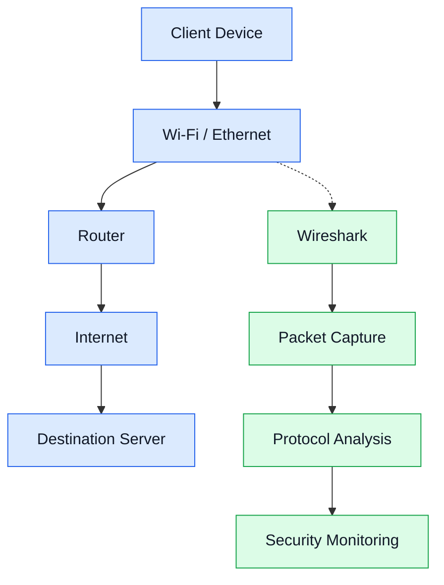
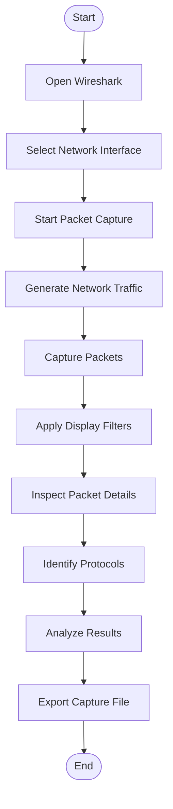
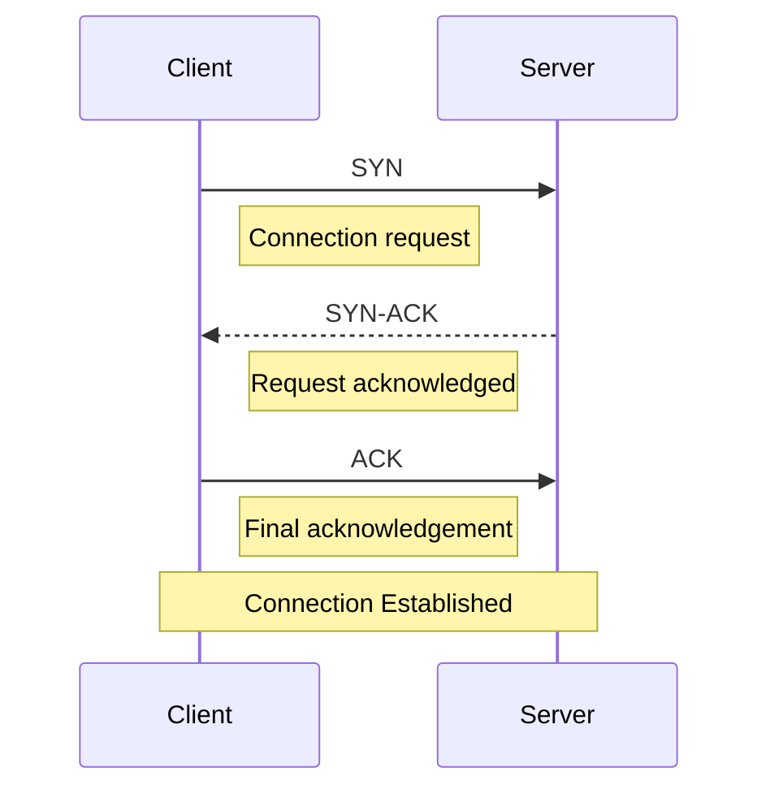
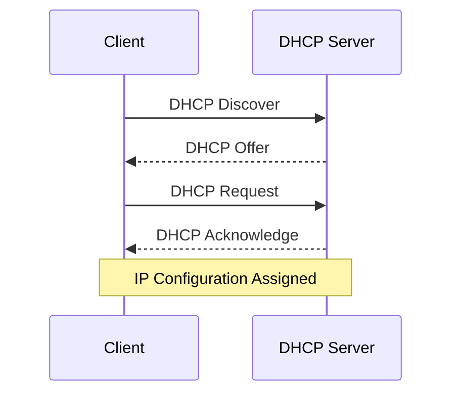

# Wireshark Network Protocol Analysis

<p align="center">
  
  
  
  
</p>

## 1. Project Overview

Wireshark Network Protocol Analysis is a networking and
cybersecurity project focused on capturing, monitoring,
and analyzing network traffic using Wireshark.

Wireshark is an open-source network protocol analyzer
that allows users to inspect packets transmitted across
a network.

This project explores commonly used network protocols,
packet capturing techniques, protocol identification,
display filters, and basic network security observations.

## 2. Project Objectives

- Understand network communication.
- Capture network packets using Wireshark.
- Identify different network protocols.
- Analyze packet headers and communication details.
- Understand TCP connection establishment.
- Analyze DNS queries and responses.
- Learn Wireshark display filters.
- Identify basic network security indicators.

## 3. Tools and Technologies

| Tool / Technology | Purpose |
|:---|:---|
| Wireshark | Network packet analysis |
| TCP/IP | Network communication |
| ARP | IP-to-MAC address resolution |
| DNS | Domain name resolution |
| DHCP | Automatic IP configuration |
| HTTP/HTTPS | Web communication |
| ICMP | Network diagnostics |
| TLS | Secure communication |
| PCAPNG | Packet capture format |
| Windows/Linux | Operating system |

## 4. Protocols Analyzed

| Protocol | Port | Description |
|:---|:---:|:---|
| ARP | N/A | Maps IPv4 addresses to MAC addresses |
| DNS | 53 | Resolves domain names into IP addresses |
| DHCP | 67/68 | Assigns IP configuration |
| HTTP | 80 | Transfers web content |
| HTTPS | 443 | Secure web communication |
| TCP | N/A | Reliable data transmission |
| UDP | N/A | Connectionless communication |
| ICMP | N/A | Network diagnostics |
| TLS | N/A | Encrypts network communication |

### 4.1 ARP - Address Resolution Protocol

ARP resolves an IPv4 address into its corresponding
MAC address within a local network.

**Display Filter:**
`arp`

### 4.2 DNS - Domain Name System

DNS translates human-readable domain names into
IP addresses.

**Display Filter:**
`dns`

### 4.3 DHCP - Dynamic Host Configuration Protocol

DHCP automatically assigns IP addresses and other
network configuration details to devices.

**Display Filter:**
`dhcp`

### 4.4 TCP - Transmission Control Protocol

TCP provides reliable and ordered data transmission
using acknowledgements, sequence numbers, and
retransmissions.

**Display Filter:**
`tcp`

### 4.5 UDP - User Datagram Protocol

UDP provides connectionless communication with
low overhead and is commonly used for DNS and
real-time applications.

**Display Filter:**
`udp`

### 4.6 HTTP - Hypertext Transfer Protocol

HTTP is an application-layer protocol used for
communication between web browsers and servers.

**Display Filter:**
`http`

### 4.7 HTTPS - Hypertext Transfer Protocol Secure

HTTPS uses TLS to protect communication between
web clients and servers through encryption.

**Display Filter:**
`tls`

### 4.8 ICMP - Internet Control Message Protocol

ICMP is used for network diagnostics and error
reporting. The ping command commonly uses ICMP.

**Display Filter:**
`icmp`

### 4.9 TLS - Transport Layer Security

TLS provides encryption and authentication for
network communications.

**Display Filter:**
`tls`

---

## 5. Network Architecture

The following diagram represents a basic network
environment monitored using Wireshark.



## 6. Packet Capture Workflow

The following flowchart describes the process
of capturing and analyzing network traffic.



## 7. TCP Three-Way Handshake

TCP establishes a connection using a three-step
handshake process.



### Explanation

1. SYN: Client requests a connection.
2. SYN-ACK: Server acknowledges the request.
3. ACK: Client confirms the connection.

## 8. DHCP DORA Process

DHCP uses four stages to assign network
configuration to a client device.



## 9. Wireshark Display Filters

The following filters can be used to identify
specific types of network traffic.

| Purpose | Display Filter |
|:---|:---|
| ARP packets | `arp` |
| DNS packets | `dns` |
| DHCP packets | `dhcp` |
| TCP packets | `tcp` |
| UDP packets | `udp` |
| HTTP packets | `http` |
| TLS packets | `tls` |
| ICMP packets | `icmp` |
| Specific IP | `ip.addr == 192.168.1.1` |
| Source IP | `ip.src == 192.168.1.1` |
| Destination IP | `ip.dst == 192.168.1.1` |
| TCP port 443 | `tcp.port == 443` |
| DNS queries | `dns.flags.response == 0` |
| TCP SYN packets | `tcp.flags.syn == 1` |

## 10. Project Directory Structure

```text
Wireshark-Network-Analysis/
│
├── README.md
│
├── docs/
│   ├── protocol_analysis.md
│   └── security_observations.md
│
├── reports/
│   └── Wireshark_Protocol_Analysis_Report.pdf
│
├── captures/
│   └── sample_capture.pcapng
│
├── screenshots/
│   ├── wireshark_dashboard.png
│   ├── arp_analysis.png
│   ├── dns_analysis.png
│   ├── tcp_analysis.png
│   └── protocol_hierarchy.png
│
├── diagrams/
│   ├── network_architecture.md
│   ├── packet_capture_flow.md
│   └── tcp_handshake.md
│
└── filters/
    └── wireshark_filters.txt
```

## 11. Installation and Usage

### Step 1: Download Wireshark

Download Wireshark from its official website:

https://www.wireshark.org/download.html

### Step 2: Launch Wireshark

Open Wireshark and select the active network
interface, such as Wi-Fi or Ethernet.

### Step 3: Start Packet Capture

Click the Start Capture button to begin
monitoring network traffic.

### Step 4: Generate Network Traffic

Generate traffic using a web browser or
network diagnostic commands.

### Step 5: Apply Display Filters

Examples:

```text
arp
dns
tcp
udp
http
tls
icmp
```

### Step 6: Inspect Packets

Analyze the following information:

- Source IP address
- Destination IP address
- Source and destination ports
- Protocol type
- Packet length
- Packet details

### Step 7: Export Capture

Save the captured network traffic in PCAPNG
format for future analysis.

## 12. Security Observations

Wireshark can help identify unusual network
communication patterns.

| Observation | Possible Concern |
|:---|:---|
| Unencrypted HTTP traffic | Sensitive data exposure |
| Unexpected DNS requests | Suspicious domain communication |
| Repeated TCP attempts | Connectivity issues or scanning |
| Unusual ARP responses | Possible ARP spoofing |
| High retransmissions | Network performance issues |
| Unknown destinations | Requires further investigation |

These observations are indicators for further
investigation and do not independently prove
malicious activity.

## 13. Learning Outcomes

After completing this project, the following
concepts can be understood:

- Network packet capturing.
- TCP/IP communication.
- OSI model and network protocols.
- TCP three-way handshake.
- DNS query and response analysis.
- DHCP address assignment.
- Wireshark display filtering.
- Basic network security monitoring.

## 14. Results and Discussion

The project provides a practical understanding
of network packet analysis using Wireshark.

Protocol identification and packet inspection
help explain how devices communicate over
a network.

The Protocol Hierarchy, Conversations, and
Endpoints features can be used to examine
captured network traffic.

**Note:** Actual packet counts, protocol
percentages, IP addresses, and experimental
screenshots should be added after performing
a real packet capture.

## 15. Conclusion

Wireshark is an effective tool for understanding
network communication and analyzing network
protocols.

This project demonstrates packet capturing,
protocol identification, display filtering, and
basic network security observations.

It provides a foundation for further learning
in networking, cybersecurity, and network
troubleshooting.

## 16. References

1. Wireshark Official Website:
   https://www.wireshark.org/

2. Wireshark Documentation:
   https://www.wireshark.org/docs/

3. RFC Editor:
   https://www.rfc-editor.org/

4. TCP Specification - RFC 9293:
   https://www.rfc-editor.org/rfc/rfc9293

5. DNS Specification - RFC 1035:
   https://www.rfc-editor.org/rfc/rfc1035

6. TLS Specification - RFC 8446:
   https://www.rfc-editor.org/rfc/rfc8446

---

## Project Information

| Field | Details |
|:---|:---|
| Project Name | Wireshark Network Protocol Analysis |
| Domain | Networking and Cybersecurity |
| Primary Tool | Wireshark |
| Project Type | Practical Analysis |
| File Format | PCAPNG / Markdown |

## Disclaimer

This project is intended for educational purposes
and authorized network analysis only.

Only capture and analyze network traffic on
systems and networks where you have permission.

---

<p align="center">
  <b>Wireshark Network Protocol Analysis</b>
  <br>
  Learning Networking Through Packet Analysis
</p>
